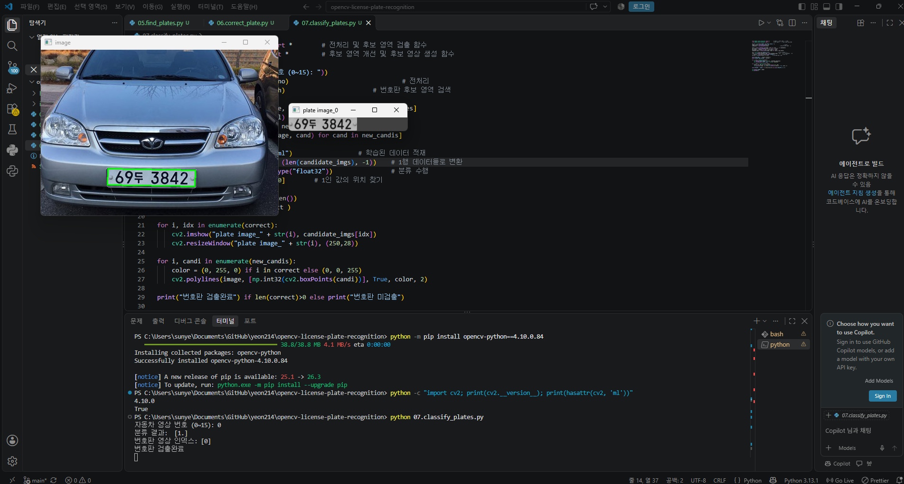

# 🚘 OpenCV License Plate Recognition

OpenCV와 Python을 활용한 **차량 번호판 검출 및 인식 프로젝트**입니다.

『OpenCV-Python으로 배우는 영상 처리 및 응용』의 예제 코드를 기반으로 SVM을 활용한 번호판 검출 과정을 실습하고, 향후 K-NN 기반 문자 인식 및 영상 전처리 성능 개선 실험을 진행할 예정입니다.

## 🛠 Tech Stack

- **Language:** Python
- **Library:** OpenCV, NumPy
- **Algorithm:** SVM (Support Vector Machine)
- **Environment:** VS Code

## 📌 Implementation

| File | Description |
|---|---|
| `04.train_plate_data.py` | SVM 학습 데이터 생성 및 모델 학습 |
| `05.find_plates.py` | 차량 이미지에서 번호판 후보 영역 검출 |
| `06.correct_plate.py` | 번호판 후보 영역 보정 |
| `07.classify_plates.py` | SVM을 활용한 번호판 영역 분류 |
| `header/` | 영상 전처리 및 번호판 검출 관련 함수 |

## 📸 Detection Results

### 1. 번호판 후보 영역 검출
차량 이미지에서 번호판으로 추정되는 영역을 탐색합니다.

### 2. SVM 기반 번호판 검출
후보 영역을 분류하여 최종 번호판 영역을 검출하고 추출합니다.

## 📌 Implementation

- SVM 기반 차량 번호판 후보 영역 검출 및 분류
- 번호판 후보 영역 보정 및 최종 번호판 추출
- 조명 변화에 따른 번호판 검출 성능 비교
- 히스토그램 평활화 및 이진화 임계값 조정을 통한 검출 성능 개선
- 다양한 밝기의 차량 이미지를 활용한 개선 전후 성능 비교
  
## 🚀 Future Work

- K-NN 기반 번호판 문자 인식 기능 구현
- 다양한 차량 이미지를 활용한 검출 성공률 분석

## 📚 Reference

정성환, 배종욱, 『OpenCV-Python으로 배우는 영상 처리 및 응용』

본 프로젝트는 해당 도서의 예제 코드를 참고하여 학습 및 실습한 내용을 기반으로 합니다.

## 📝 Development Log

구현 과정 및 성능 개선 실험은 추후 Velog에 정리할 예정입니다.

**Velog:** https://velog.io/@sunyeon1115/posts
